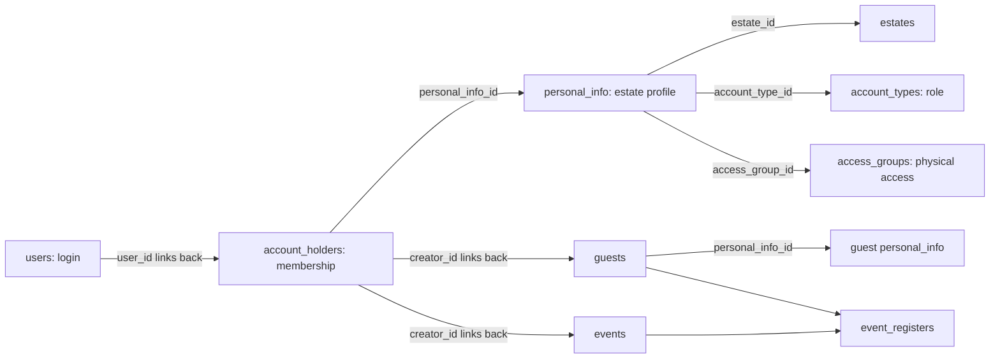

# Gate Access database: a student’s guide

**Edition:** 2 October 2026 · **Database:** MySQL 8.4 · **Schema revision:** `mysql_0003`

This guide explains the database that supports the Gate Access application: what every table stores, how the tables work together, which rules MySQL enforces, and why the PostgreSQL-to-MySQL conversion took its current form.

It describes the current repository models and migrations, with selected API code checked for context. It is not a claim that every API endpoint has been tested or deployed. The examples use fictional people and IDs, not production records. No passwords, private keys, or actual user contact details are included.

Some choices were inherited from the original application. Where we explain a useful design rationale, that is an explanation of the design’s benefit, not a claim that an original author documented that exact intention. Migration-specific decisions and the trigger repair are explained separately.

## How to use this guide

Read sections 1–3 first. Then use the table directory to look up a particular table. Sections 5–9 explain the rules that connect the tables. The final sections provide read-only SQL exercises, operational context, and links to the implementation.

## 1. The problem the database solves

Imagine an estate called Cedar Court. A resident has a login, a membership in Cedar Court, a vehicle, and permission to pass through certain gates. The resident can invite a guest, register that guest for an event, and report an issue. Gate controllers send heartbeats and device measurements. The system records access activity and administrative actions.

A single enormous table would repeat the resident’s login details for every vehicle, guest, and event. Updating one piece of information would require many edits. This database instead separates concepts and links them with IDs. That organization is called **normalization**: keep each kind of fact in its appropriate place and use relationships to connect facts.

## 2. Database vocabulary, with examples

| Term | Meaning in this project |
|---|---|
| Table | A collection of one kind of record, such as `vehicles`. |
| Row | One record, such as one vehicle. |
| Column | One property, such as `license_plate_number`. |
| Primary key (PK) | The value, or combination of values, that uniquely identifies a row. |
| Foreign key (FK) | A reference to a real row in another table, such as a vehicle’s `personal_info_id`. |
| Composite key | A key made from multiple columns. A gate/group link is identified by both IDs together. |
| `NULL` | A missing or not-applicable value. It is not zero, an empty string, or automatically an error. |
| Default | The database’s fallback when an INSERT omits a column. Explicit NULL is different from omission. |
| `UNIQUE` | A database rule preventing duplicate non-NULL keys. It does not automatically validate spelling or format. |
| `CHECK` | A rule tested against a row, such as an event ending after it starts. |
| Index | An extra lookup structure that helps queries find rows faster; it adds storage and write cost. |
| Transaction | A group of operations committed together or rolled back together. |
| Trigger | SQL that MySQL automatically runs when a specified table is inserted into or updated. |
| Migration | A versioned change to the database’s structure or rules. |
| Soft delete | Mark a record deleted using `deleted_at`, while physically retaining it. |
| Hard delete | Actually remove a row with DELETE, potentially activating foreign-key delete rules. |

A key distinction: **an ID has meaning only with its table**. User 20, account holder 20, and personal-info record 20 can refer to three different things. Never substitute IDs merely because their numbers match.

## 3. The three identities to understand first

| Concept | Table | Question it answers |
|---|---|---|
| Login identity | `users` | Who can authenticate to the application? |
| Estate membership | `account_holders` | Which user belongs to which estate context? |
| Person’s estate profile | `personal_info` | What is this person’s name, estate, role, and access group? |

Example: fictional user **20** has membership **81**, which points to personal-info record **300** in estate **5**. The path is `users.id=20 ← account_holders.user_id`, followed by `account_holders.personal_info_id=300 → personal_info.id`, followed by `personal_info.estate_id=5 → estates.id`.

The account holder’s estate is obtained through personal info; `account_holders` does not have its own `estate_id`. One login may have memberships in multiple estates. The rule is at most one **non-soft-deleted** membership for a user in an estate, not one membership for the entire system.

A guest also has personal information but does not need a login. A guest’s `personal_info_id` describes the guest, while `creator_id` identifies the inviting account holder. Joining a guest’s personal-info record to an account holder’s personal-info record does not, in general, reveal the guest’s host.



The arrows illustrate navigation, not strict mandatory one-to-one cardinality. Several foreign keys are nullable, and `personal_info_id` is not generally UNIQUE on its referring tables.

## 4. Table directory and detailed reference

There are **25 application tables**, plus Alembic’s administrative `alembic_version` table. The sections below include every modeled column, its MySQL type, whether NULL is allowed, and the database default. Constraints and indexes are extracted from the actual SQLAlchemy metadata, rather than guessed from column names.

Common conventions: `date_created` records insertion time; `date_updated` records the latest SQL UPDATE through a trigger, including updates that assign the same value. These are not a full history of changes. Integer standalone primary keys normally auto-increment. Link-table composite keys and `faces.id` do not.

| Table | Main responsibility |
|---|---|
| [users](#table-users) | The authentication identity |
| [pending_users](#table-pending-users) | A staging area for an unverified login registration, including its OTP and expiry. |
| [estates](#table-estates) | The communities or sites managed by the system |
| [account_types](#table-account-types) | The catalogue of roles or account categories |
| [privileges](#table-privileges) | The catalogue of named actions, such as CREATE_GUESTS or VIEW_LOGS. |
| [account_type_privilege_links](#table-account-type-privilege-links) | The many-to-many connection between roles and privileges. |
| [access_groups](#table-access-groups) | Named physical-access categories within an estate, such as REGULAR or MANAGEMENT. |
| [personal_info](#table-personal-info) | An estate-specific profile containing a person’s name, optional identity/contact information, role, access group, and optional expiry. |
| [account_holders](#table-account-holders) | The membership that connects a login user to an estate profile and house address |
| [pending_account_holders](#table-pending-account-holders) | An invitation or membership record waiting for acceptance/verification, including the intended profile, house address, email, and optional parent account holder. |
| [personal_info_privilege_links](#table-personal-info-privilege-links) | Individual privilege grants attached to a profile rather than a role. |
| [gates](#table-gates) | The estate’s access points and selected controller-health information. |
| [gate_access_group_links](#table-gate-access-group-links) | The many-to-many connection between gates and access groups, with a permitted time window for each pair. |
| [personal_info_gate_links](#table-personal-info-gate-links) | A direct gate-access relationship for a particular profile, with its own opening and closing times. |
| [vehicles](#table-vehicles) | Vehicle details associated with a personal-info record: plate, make, model, and color. |
| [guests](#table-guests) | The visit/guest record, with an optional personal profile, an optional inviting account holder, status, and JSON details. |
| [events](#table-events) | An event owned by an account holder, with its name, capacity, and start/end instants. |
| [event_registers](#table-event-registers) | The join records assigning guests to events. |
| [faces](#table-faces) | A mapping from a face identifier to a guest record. |
| [accesslog](#table-accesslog) | A concise history of gate activity keyed by vehicle plate, event text, gate, and timestamp. |
| [logs](#table-logs) | General application/audit messages, optionally associated with an estate, an actor user, a target account holder, and a vehicle plate. |
| [messagedb](#table-messagedb) | Topic-labelled messages stored as text with their creation time and an optional originating gate. |
| [system_metrics](#table-system-metrics) | Time-series readings from gate/controller infrastructure, such as temperatures, camera availability, services, and storage usage. |
| [user_reports](#table-user-reports) | Issue reports submitted by a login user, with subject and detailed description. |
| [report_status](#table-report-status) | The current status associated with a report. |

<a id="table-users"></a>

### 4.1. `users`

The authentication identity. Stores login identifiers, a password representation, account flags, password-reset information, and a soft-delete marker.

**How it works:** A resident signs up with an email or phone number. Once registration is verified, the API can establish a user account. Estate memberships are separate records, so the same login can serve more than one estate.

**Why this structure:** Keeping authentication separate avoids copying a password into every estate membership. The password and reset OTP columns are intended for protected representations produced by application code; MySQL does not hash their contents automatically.

**Columns**

| Column | MySQL type | NULL allowed? | Database default | Meaning |
|---|---|---|---|---|
| `id` | `INTEGER` | No | `AUTO_INCREMENT` | Identifier for this row; meaningful only within this table. |
| `email` | `VARCHAR(255)` | Yes | `None` | Email identifier; normalization and verification belong to the application. |
| `phone_number` | `VARCHAR(20)` | Yes | `None` | Phone identifier; canonical formatting and verification belong to the application. |
| `password` | `VARCHAR(255)` | No | `None` | Password representation supplied by the application; the database does not hash it. |
| `reset_otp` | `VARCHAR(255)` | Yes | `None` | Protected password-reset OTP representation, when a reset is in progress. |
| `reset_expiry` | `DATETIME(6)` | Yes | `None` | Expiry instant for the reset workflow. |
| `is_active` | `BOOL` | No | `true` | Activation flag. Separate from deleted_at; inactive is not the same as deleted. |
| `is_admin` | `BOOL` | No | `false` | Application administrator flag; the API decides which operations it authorizes. |
| `date_created` | `DATETIME(6)` | No | `CURRENT_TIMESTAMP(6)` | Creation timestamp. Defaults to the database clock; treat stored DATETIME values as UTC. |
| `date_updated` | `DATETIME(6)` | No | `CURRENT_TIMESTAMP(6)` | Last update timestamp maintained by the database trigger; not a history of earlier values. |
| `deleted_at` | `DATETIME(6)` | Yes | `None` | NULL means not soft-deleted; a timestamp marks soft deletion. Does not physically remove the row. |

**Keys, relationships, and lookup rules**

- Primary key: `id`.
- CHECK: `email IS NOT NULL OR phone_number IS NOT NULL`.
- Index `ix_users_deleted_at`: `users.deleted_at`.
- UNIQUE index `uq_users_email`: `(CASE WHEN deleted_at IS NULL THEN email ELSE NULL END)`.
- UNIQUE index `uq_users_phone_number`: `(CASE WHEN deleted_at IS NULL THEN phone_number ELSE NULL END)`.

**Important boundaries:** At least one of email and phone must be non-NULL. Functional UNIQUE indexes enforce identifier uniqueness only for rows with deleted_at IS NULL. is_active=False does not release an identifier. Database checks do not establish valid email syntax, phone normalization, password strength, or that an administrator is authorized to change is_admin.

<a id="table-pending-users"></a>

### 4.2. `pending_users`

A staging area for an unverified login registration, including its OTP and expiry.

**How it works:** The application creates or refreshes a pending registration, verifies the supplied OTP and expiry, and then creates the actual user. Application code must complete the transition; no database trigger promotes pending users.

**Why this structure:** Separating unverified registrations from users keeps the authentication table focused on established accounts. Wider OTP columns accommodate hashed values rather than limiting storage to a few display digits.

**Columns**

| Column | MySQL type | NULL allowed? | Database default | Meaning |
|---|---|---|---|---|
| `id` | `INTEGER` | No | `AUTO_INCREMENT` | Identifier for this row; meaningful only within this table. |
| `email` | `VARCHAR(255)` | Yes | `None` | Email identifier; normalization and verification belong to the application. |
| `password` | `VARCHAR(255)` | No | `None` | Password representation supplied by the application; the database does not hash it. |
| `phone_number` | `VARCHAR(20)` | Yes | `None` | Phone identifier; canonical formatting and verification belong to the application. |
| `otp` | `VARCHAR(255)` | No | `None` | OTP representation; application code is responsible for generating, protecting, and verifying it. |
| `otp_expiry` | `DATETIME(6)` | No | `None` | OTP expiry instant; application checks whether it has passed. |
| `date_created` | `DATETIME(6)` | No | `CURRENT_TIMESTAMP(6)` | Creation timestamp. Defaults to the database clock; treat stored DATETIME values as UTC. |
| `date_updated` | `DATETIME(6)` | No | `CURRENT_TIMESTAMP(6)` | Last update timestamp maintained by the database trigger; not a history of earlier values. |

**Keys, relationships, and lookup rules**

- Primary key: `id`.
- UNIQUE: `email`.
- UNIQUE: `phone_number`.

**Important boundaries:** Email and phone each have ordinary UNIQUE rules, but can be NULL. Unlike users, this table has no at-least-one-identifier CHECK and no soft delete. Expired rows are not deleted automatically by a trigger; cleanup and verification are application responsibilities.

<a id="table-estates"></a>

### 4.3. `estates`

The communities or sites managed by the system. Each estate has a name and a location representation.

**How it works:** Creating Cedar Court inserts an estate and automatically creates its REGULAR access group in the same transaction.

**Why this structure:** An estate is the boundary around profiles, gates, access groups, and much of authorization. Keeping it as a parent avoids repeating estate details on every record.

**Columns**

| Column | MySQL type | NULL allowed? | Database default | Meaning |
|---|---|---|---|---|
| `id` | `INTEGER` | No | `AUTO_INCREMENT` | Identifier for this row; meaningful only within this table. |
| `name` | `VARCHAR(255)` | No | `None` | Human-readable name; uniqueness depends on the constraints listed below. |
| `location_coordinates` | `VARCHAR(255)` | No | `None` | Location stored as a unique VARCHAR string, not a validated geospatial type. |
| `date_created` | `DATETIME(6)` | No | `CURRENT_TIMESTAMP(6)` | Creation timestamp. Defaults to the database clock; treat stored DATETIME values as UTC. |
| `date_updated` | `DATETIME(6)` | No | `CURRENT_TIMESTAMP(6)` | Last update timestamp maintained by the database trigger; not a history of earlier values. |

**Keys, relationships, and lookup rules**

- Primary key: `id`.
- UNIQUE: `location_coordinates`.
- UNIQUE: `name`.

**Important boundaries:** Name and location_coordinates are independently UNIQUE. Coordinates are stored as text, not a spatial POINT; MySQL does not validate latitude/longitude format here. Hard deletion cascades into estate-owned tables, while related logs retain their text and lose the estate reference.

<a id="table-account-types"></a>

### 4.4. `account_types`

The catalogue of roles or account categories. A profile chooses one account type.

**How it works:** A role such as USER_A can be associated with CREATE_GUESTS through account_type_privilege_links. The role is assigned through personal_info.account_type_id.

**Why this structure:** Role names live in one table so many people can share a consistent role and its baseline permissions.

**Columns**

| Column | MySQL type | NULL allowed? | Database default | Meaning |
|---|---|---|---|---|
| `id` | `INTEGER` | No | `AUTO_INCREMENT` | Identifier for this row; meaningful only within this table. |
| `name` | `VARCHAR(100)` | No | `None` | Human-readable name; uniqueness depends on the constraints listed below. |
| `date_created` | `DATETIME(6)` | No | `CURRENT_TIMESTAMP(6)` | Creation timestamp. Defaults to the database clock; treat stored DATETIME values as UTC. |
| `date_updated` | `DATETIME(6)` | No | `CURRENT_TIMESTAMP(6)` | Last update timestamp maintained by the database trigger; not a history of earlier values. |

**Keys, relationships, and lookup rules**

- Primary key: `id`.
- UNIQUE: `name`.

**Important boundaries:** The local fresh-install seed lists ADMIN, USER_A, GUEST, and WORKER. A transferred database can contain additional roles and preserves their IDs. Never assume all production role IDs from a fresh seed. The database permits any unique name; role meaning is supplied by application policy.

<a id="table-privileges"></a>

### 4.5. `privileges`

The catalogue of named actions, such as CREATE_GUESTS or VIEW_LOGS.

**How it works:** A privilege is attached either to an account type or directly to a personal-info record through the appropriate link table.

**Why this structure:** A catalogue lets permissions be combined without adding a new Boolean column every time the application introduces an action.

**Columns**

| Column | MySQL type | NULL allowed? | Database default | Meaning |
|---|---|---|---|---|
| `id` | `INTEGER` | No | `AUTO_INCREMENT` | Identifier for this row; meaningful only within this table. |
| `name` | `VARCHAR(100)` | No | `None` | Human-readable name; uniqueness depends on the constraints listed below. |
| `date_created` | `DATETIME(6)` | No | `CURRENT_TIMESTAMP(6)` | Creation timestamp. Defaults to the database clock; treat stored DATETIME values as UTC. |
| `date_updated` | `DATETIME(6)` | No | `CURRENT_TIMESTAMP(6)` | Last update timestamp maintained by the database trigger; not a history of earlier values. |

**Keys, relationships, and lookup rules**

- Primary key: `id`.
- UNIQUE: `name`.

**Important boundaries:** A privilege name does not enforce itself. API authorization code must check it before acting. Names must match the strings expected by that code. The database does not automatically grant every privilege to an account marked is_admin.

<a id="table-account-type-privilege-links"></a>

### 4.6. `account_type_privilege_links`

The many-to-many connection between roles and privileges.

**How it works:** A role can have many privilege links, and one privilege can be shared by several roles. The pair (account_type_id, privilege_id) identifies one assignment.

**Why this structure:** A composite primary key represents the relationship directly and prevents the same permission from being assigned twice to the same role.

**Columns**

| Column | MySQL type | NULL allowed? | Database default | Meaning |
|---|---|---|---|---|
| `account_type_id` | `INTEGER` | No | `None` | Reference to the role/category catalogue. |
| `privilege_id` | `INTEGER` | No | `None` | Reference to a named application permission. |
| `date_created` | `DATETIME(6)` | No | `CURRENT_TIMESTAMP(6)` | Creation timestamp. Defaults to the database clock; treat stored DATETIME values as UTC. |
| `date_updated` | `DATETIME(6)` | No | `CURRENT_TIMESTAMP(6)` | Last update timestamp maintained by the database trigger; not a history of earlier values. |

**Keys, relationships, and lookup rules**

- Primary key: `account_type_id`, `privilege_id`.
- Foreign key: `account_type_id` → `account_types.id`; on hard delete: **CASCADE**.
- Foreign key: `privilege_id` → `privileges.id`; on hard delete: **CASCADE**.
- Index `ix_account_type_privilege_links_privilege_id`: `account_type_privilege_links.privilege_id`.

**Important boundaries:** This stores baseline grants, not explicit denials. Removing a link removes that role grant, but a person might still hold a direct grant or satisfy another application authorization rule.

<a id="table-access-groups"></a>

### 4.7. `access_groups`

Named physical-access categories within an estate, such as REGULAR or MANAGEMENT.

**How it works:** A profile belongs to one access group. Linking that group to a gate allows the API to consider the group’s members when calculating access.

**Why this structure:** Groups let many people share gate access and time windows without inserting a separate record for every person/gate pair.

**Columns**

| Column | MySQL type | NULL allowed? | Database default | Meaning |
|---|---|---|---|---|
| `id` | `INTEGER` | No | `AUTO_INCREMENT` | Identifier for this row; meaningful only within this table. |
| `estate_id` | `INTEGER` | No | `None` | Reference to the estate/site that owns this record. |
| `name` | `VARCHAR(255)` | No | `None` | Human-readable name; uniqueness depends on the constraints listed below. |
| `date_created` | `DATETIME(6)` | No | `CURRENT_TIMESTAMP(6)` | Creation timestamp. Defaults to the database clock; treat stored DATETIME values as UTC. |
| `date_updated` | `DATETIME(6)` | No | `CURRENT_TIMESTAMP(6)` | Last update timestamp maintained by the database trigger; not a history of earlier values. |

**Keys, relationships, and lookup rules**

- Primary key: `id`.
- Foreign key: `estate_id` → `estates.id`; on hard delete: **CASCADE**.
- UNIQUE: `name`, `estate_id`.
- Index `ix_access_groups_estate_id`: `access_groups.estate_id`.

**Important boundaries:** Group names are unique within an estate, not globally. REGULAR can exist in several estates. A role controls application actions; an access group describes physical access. They are separate concepts even when their names sound similar.

<a id="table-personal-info"></a>

### 4.8. `personal_info`

An estate-specific profile containing a person’s name, optional identity/contact information, role, access group, and optional expiry.

**How it works:** A resident’s account holder points here; a guest or pending invitation can also point here. A person without a login can still have a profile and a vehicle.

**Why this structure:** The shared profile lets residents and guests participate in common physical-access relationships without requiring everyone to have authentication credentials.

**Columns**

| Column | MySQL type | NULL allowed? | Database default | Meaning |
|---|---|---|---|---|
| `id` | `INTEGER` | No | `AUTO_INCREMENT` | Identifier for this row; meaningful only within this table. |
| `estate_id` | `INTEGER` | No | `None` | Reference to the estate/site that owns this record. |
| `name` | `VARCHAR(255)` | No | `None` | Human-readable name; uniqueness depends on the constraints listed below. |
| `id_type` | `VARCHAR(50)` | Yes | `None` | Optional identity-document category. |
| `id_num` | `VARCHAR(100)` | Yes | `None` | Optional identity-document identifier; unique with type and estate when all are non-NULL. |
| `contact` | `VARCHAR(50)` | Yes | `None` | Profile contact text; distinct from the login’s verified phone/email. |
| `expiry` | `DATETIME(6)` | Yes | `None` | Optional profile/access expiry instant; application must evaluate it. |
| `account_type_id` | `INTEGER` | No | `1` | Reference to the role/category catalogue. |
| `access_group_id` | `INTEGER` | No | `1` | Reference to the physical-access group. |
| `date_created` | `DATETIME(6)` | No | `CURRENT_TIMESTAMP(6)` | Creation timestamp. Defaults to the database clock; treat stored DATETIME values as UTC. |
| `date_updated` | `DATETIME(6)` | No | `CURRENT_TIMESTAMP(6)` | Last update timestamp maintained by the database trigger; not a history of earlier values. |

**Keys, relationships, and lookup rules**

- Primary key: `id`.
- Foreign key: `access_group_id` → `access_groups.id`; on hard delete: **RESTRICT / NO ACTION (block deletion while referenced)**.
- Foreign key: `account_type_id` → `account_types.id`; on hard delete: **RESTRICT / NO ACTION (block deletion while referenced)**.
- Foreign key: `estate_id` → `estates.id`; on hard delete: **CASCADE**.
- UNIQUE: `id_type`, `id_num`, `estate_id`.
- Index `ix_personal_info_access_group_id`: `personal_info.access_group_id`.
- Index `ix_personal_info_account_type_id`: `personal_info.account_type_id`.
- Index `ix_personal_info_estate_id`: `personal_info.estate_id`.

**Important boundaries:** The tuple (id_type, id_num, estate_id) is UNIQUE, but NULL components allow multiple incomplete identities. Role and group default to numeric ID 1; an estate’s generated REGULAR group is not necessarily ID 1. The API should supply the correct role and same-estate group explicitly. Existing foreign keys alone do not enforce that group and profile belong to the same estate. A guard trigger blocks changing estate_id when any account-holder row references the profile.

<a id="table-account-holders"></a>

### 4.9. `account_holders`

The membership that connects a login user to an estate profile and house address. It can also describe a subordinate account through a parent membership reference.

**How it works:** User 20 joins Cedar Court: insert personal info in that estate, then insert an account holder referencing user 20 and that profile. Activation and soft deletion are separate from the initial insertion.

**Why this structure:** An estate membership is the correct owner for estate-specific invitations and events. It identifies both the person and the context in which they act. The parent membership field supports household or delegated accounts.

**Columns**

| Column | MySQL type | NULL allowed? | Database default | Meaning |
|---|---|---|---|---|
| `id` | `INTEGER` | No | `AUTO_INCREMENT` | Identifier for this row; meaningful only within this table. |
| `user_id` | `INTEGER` | No | `None` | Reference to a login identity in users. |
| `personal_info_id` | `INTEGER` | Yes | `None` | Reference to the person’s estate-specific profile; not a login user ID. |
| `house_address` | `VARCHAR(255)` | No | `None` | Membership or invitation house/unit address. |
| `otp` | `VARCHAR(255)` | Yes | `None` | OTP representation; application code is responsible for generating, protecting, and verifying it. |
| `otp_generated_at` | `DATETIME(6)` | Yes | `None` | Timestamp used by the application’s OTP workflow; inspect the handler for its validity calculation. |
| `owner_account_holder_id` | `INTEGER` | Yes | `None` | Optional parent/owning membership for a subordinate account or invitation. |
| `is_active` | `BOOL` | No | `false` | Activation flag. Separate from deleted_at; inactive is not the same as deleted. |
| `date_created` | `DATETIME(6)` | No | `CURRENT_TIMESTAMP(6)` | Creation timestamp. Defaults to the database clock; treat stored DATETIME values as UTC. |
| `date_updated` | `DATETIME(6)` | No | `CURRENT_TIMESTAMP(6)` | Last update timestamp maintained by the database trigger; not a history of earlier values. |
| `deleted_at` | `DATETIME(6)` | Yes | `None` | NULL means not soft-deleted; a timestamp marks soft deletion. Does not physically remove the row. |

**Keys, relationships, and lookup rules**

- Primary key: `id`.
- Foreign key: `owner_account_holder_id` → `account_holders.id`; on hard delete: **SET NULL**.
- Foreign key: `personal_info_id` → `personal_info.id`; on hard delete: **CASCADE**.
- Foreign key: `user_id` → `users.id`; on hard delete: **CASCADE**.
- Index `ix_account_holders_deleted_at`: `account_holders.deleted_at`.
- Index `ix_account_holders_owner_account_holder_id`: `account_holders.owner_account_holder_id`.
- Index `ix_account_holders_personal_info_id`: `account_holders.personal_info_id`.
- Index `ix_account_holders_user_id`: `account_holders.user_id`.

**Important boundaries:** The membership trigger counts non-soft-deleted rows, regardless of is_active. is_active defaults false. personal_info_id is nullable; a row without it has no resolvable estate and bypasses that uniqueness check. Hard-deleting the parent membership sets owner_account_holder_id to NULL in existing child memberships, but does not delete those children through that self-reference. No CHECK prevents self-parenting or cycles; application validation is needed.

<a id="table-pending-account-holders"></a>

### 4.10. `pending_account_holders`

An invitation or membership record waiting for acceptance/verification, including the intended profile, house address, email, and optional parent account holder.

**How it works:** The subaccount API creates an invitation and verifies its OTP before establishing the real membership. This table has no user_id column.

**Why this structure:** A person may be invited before their login is ready. Keeping pending membership separate avoids pretending that the invitation already represents a completed user membership.

**Columns**

| Column | MySQL type | NULL allowed? | Database default | Meaning |
|---|---|---|---|---|
| `id` | `INTEGER` | No | `AUTO_INCREMENT` | Identifier for this row; meaningful only within this table. |
| `personal_info_id` | `INTEGER` | Yes | `None` | Reference to the person’s estate-specific profile; not a login user ID. |
| `house_address` | `VARCHAR(255)` | No | `None` | Membership or invitation house/unit address. |
| `otp` | `VARCHAR(255)` | Yes | `None` | OTP representation; application code is responsible for generating, protecting, and verifying it. |
| `otp_generated_at` | `DATETIME(6)` | Yes | `None` | Timestamp used by the application’s OTP workflow; inspect the handler for its validity calculation. |
| `owner_account_holder_id` | `INTEGER` | Yes | `None` | Optional parent/owning membership for a subordinate account or invitation. |
| `is_pending` | `BOOL` | No | `true` | Whether the application considers this membership invitation pending; default true. |
| `date_created` | `DATETIME(6)` | No | `CURRENT_TIMESTAMP(6)` | Creation timestamp. Defaults to the database clock; treat stored DATETIME values as UTC. |
| `date_updated` | `DATETIME(6)` | No | `CURRENT_TIMESTAMP(6)` | Last update timestamp maintained by the database trigger; not a history of earlier values. |
| `email` | `VARCHAR(255)` | Yes | `None` | Email identifier; normalization and verification belong to the application. |

**Keys, relationships, and lookup rules**

- Primary key: `id`.
- Foreign key: `owner_account_holder_id` → `account_holders.id`; on hard delete: **CASCADE**.
- Foreign key: `personal_info_id` → `personal_info.id`; on hard delete: **CASCADE**.
- UNIQUE: `email`.
- Index `ix_pending_account_holders_owner_account_holder_id`: `pending_account_holders.owner_account_holder_id`.
- Index `ix_pending_account_holders_personal_info_id`: `pending_account_holders.personal_info_id`.

**Important boundaries:** Email is nullable and globally UNIQUE in this table, so one non-NULL email cannot have two simultaneous pending rows even in different estates. is_pending defaults true. Unlike completed child memberships, its parent FK uses CASCADE: hard-deleting the parent deletes the pending invitation. OTP validity is checked by application code, not a trigger.

<a id="table-personal-info-privilege-links"></a>

### 4.11. `personal_info_privilege_links`

Individual privilege grants attached to a profile rather than a role.

**How it works:** Two residents share USER_A, but one receives VIEW_LOGS directly. The inspected API privilege helper combines role grants and profile grants.

**Why this structure:** Direct grants provide individual exceptions without inventing a new role for every combination of permissions. Attaching grants to a profile makes them estate-contextual.

**Columns**

| Column | MySQL type | NULL allowed? | Database default | Meaning |
|---|---|---|---|---|
| `personal_info_id` | `INTEGER` | No | `None` | Reference to the person’s estate-specific profile; not a login user ID. |
| `privilege_id` | `INTEGER` | No | `None` | Reference to a named application permission. |
| `date_created` | `DATETIME(6)` | No | `CURRENT_TIMESTAMP(6)` | Creation timestamp. Defaults to the database clock; treat stored DATETIME values as UTC. |
| `date_updated` | `DATETIME(6)` | No | `CURRENT_TIMESTAMP(6)` | Last update timestamp maintained by the database trigger; not a history of earlier values. |

**Keys, relationships, and lookup rules**

- Primary key: `personal_info_id`, `privilege_id`.
- Foreign key: `personal_info_id` → `personal_info.id`; on hard delete: **CASCADE**.
- Foreign key: `privilege_id` → `privileges.id`; on hard delete: **CASCADE**.
- Index `ix_personal_info_privilege_links_privilege_id`: `personal_info_privilege_links.privilege_id`.

**Important boundaries:** The composite primary key prevents duplicate assignments. This table has no deny flag, expiry, or grantor column. It cannot by itself remove a role-level permission or preserve a permission-change audit trail.

<a id="table-gates"></a>

### 4.12. `gates`

The estate’s access points and selected controller-health information.

**How it works:** A controller heartbeat updates last_controller_heartbeat; API queries combine gate hours with group/person gate-link hours when deciding access.

**Why this structure:** Gate identity, normal operating hours, and current controller state belong together, while historical device readings belong in system_metrics.

**Columns**

| Column | MySQL type | NULL allowed? | Database default | Meaning |
|---|---|---|---|---|
| `id` | `INTEGER` | No | `AUTO_INCREMENT` | Identifier for this row; meaningful only within this table. |
| `estate_id` | `INTEGER` | No | `None` | Reference to the estate/site that owns this record. |
| `name` | `VARCHAR(255)` | No | `None` | Human-readable name; uniqueness depends on the constraints listed below. |
| `last_controller_heartbeat` | `DATETIME(6)` | No | `CURRENT_TIMESTAMP(6)` | Most recently stored controller heartbeat time; insertion supplies an initial default. |
| `opening_time` | `TIME` | No | `'00:00:00'` | Time of day when the gate/access window begins; no date or timezone is stored in TIME. |
| `closing_time` | `TIME` | No | `'23:59:59'` | Time of day when the gate/access window ends; application handles window interpretation. |
| `active` | `BOOL` | No | `true` | Whether the gate is enabled in application policy. |
| `date_created` | `DATETIME(6)` | No | `CURRENT_TIMESTAMP(6)` | Creation timestamp. Defaults to the database clock; treat stored DATETIME values as UTC. |
| `date_updated` | `DATETIME(6)` | No | `CURRENT_TIMESTAMP(6)` | Last update timestamp maintained by the database trigger; not a history of earlier values. |
| `last_alert_sent_at` | `DATETIME(6)` | Yes | `None` | Optional time used to track/throttle gate alerts. |
| `snr` | `VARCHAR(50)` | Yes | `None` | Signal-to-noise measurement stored as a string; units/format belong to the producer. |
| `rssi` | `VARCHAR(50)` | Yes | `None` | Received-signal measurement stored as a string; units/format belong to the producer. |

**Keys, relationships, and lookup rules**

- Primary key: `id`.
- Foreign key: `estate_id` → `estates.id`; on hard delete: **CASCADE**.
- UNIQUE: `name`, `estate_id`.
- Index `ix_gates_estate_id`: `gates.estate_id`.

**Important boundaries:** Names are unique per estate. active defaults true. The heartbeat defaults to insertion time; that initial value is not proof a real device has contacted the server. snr and rssi are strings in this schema. Time-window enforcement, overnight handling, and alert scheduling are application behavior, not automatic gate-opening triggers.

<a id="table-gate-access-group-links"></a>

### 4.13. `gate_access_group_links`

The many-to-many connection between gates and access groups, with a permitted time window for each pair.

**How it works:** The REGULAR group may use the main gate all day but a service gate only during specified hours. Each pair has one row.

**Why this structure:** The schedule belongs to the permission relationship: two groups can use the same gate on different schedules.

**Columns**

| Column | MySQL type | NULL allowed? | Database default | Meaning |
|---|---|---|---|---|
| `gate_id` | `INTEGER` | No | `None` | Reference to a physical gate/controller record. |
| `access_group_id` | `INTEGER` | No | `None` | Reference to the physical-access group. |
| `opening_time` | `TIME` | No | `'00:00:00'` | Time of day when the gate/access window begins; no date or timezone is stored in TIME. |
| `closing_time` | `TIME` | No | `'23:59:59'` | Time of day when the gate/access window ends; application handles window interpretation. |
| `date_created` | `DATETIME(6)` | No | `CURRENT_TIMESTAMP(6)` | Creation timestamp. Defaults to the database clock; treat stored DATETIME values as UTC. |
| `date_updated` | `DATETIME(6)` | No | `CURRENT_TIMESTAMP(6)` | Last update timestamp maintained by the database trigger; not a history of earlier values. |

**Keys, relationships, and lookup rules**

- Primary key: `gate_id`, `access_group_id`.
- Foreign key: `access_group_id` → `access_groups.id`; on hard delete: **CASCADE**.
- Foreign key: `gate_id` → `gates.id`; on hard delete: **CASCADE**.
- Index `ix_gate_access_group_links_access_group_id`: `gate_access_group_links.access_group_id`.

**Important boundaries:** The key is (gate_id, access_group_id). Foreign keys ensure both records exist, but do not ensure they belong to the same estate. The database accepts time values; it does not decide whether a window crosses midnight or how overlapping schedules should combine.

<a id="table-personal-info-gate-links"></a>

### 4.14. `personal_info_gate_links`

A direct gate-access relationship for a particular profile, with its own opening and closing times.

**How it works:** A profile can be assigned to a gate individually in addition to the relationships available through its access group. API access queries decide how these paths are combined.

**Why this structure:** This accommodates individual gate assignments without moving the person into a different access group just for one gate.

**Columns**

| Column | MySQL type | NULL allowed? | Database default | Meaning |
|---|---|---|---|---|
| `gate_id` | `INTEGER` | No | `None` | Reference to a physical gate/controller record. |
| `personal_info_id` | `INTEGER` | No | `None` | Reference to the person’s estate-specific profile; not a login user ID. |
| `opening_time` | `TIME` | No | `'00:00:00'` | Time of day when the gate/access window begins; no date or timezone is stored in TIME. |
| `closing_time` | `TIME` | No | `'23:59:59'` | Time of day when the gate/access window ends; application handles window interpretation. |
| `date_created` | `DATETIME(6)` | No | `CURRENT_TIMESTAMP(6)` | Creation timestamp. Defaults to the database clock; treat stored DATETIME values as UTC. |
| `date_updated` | `DATETIME(6)` | No | `CURRENT_TIMESTAMP(6)` | Last update timestamp maintained by the database trigger; not a history of earlier values. |

**Keys, relationships, and lookup rules**

- Primary key: `gate_id`, `personal_info_id`.
- Foreign key: `gate_id` → `gates.id`; on hard delete: **CASCADE**.
- Foreign key: `personal_info_id` → `personal_info.id`; on hard delete: **CASCADE**.
- Index `ix_personal_info_gate_links_personal_info_id`: `personal_info_gate_links.personal_info_id`.

**Important boundaries:** The pair (gate_id, personal_info_id) is the primary key. It is not an explicit deny rule. Gate/profile same-estate validation and schedule interpretation must be performed by the application.

<a id="table-vehicles"></a>

### 4.15. `vehicles`

Vehicle details associated with a personal-info record: plate, make, model, and color.

**How it works:** A resident or guest profile can have multiple vehicles. The gate API can find a vehicle’s person and evaluate the person’s permitted gates.

**Why this structure:** Linking vehicles to personal info supports both residents and guests rather than requiring a user login for every vehicle owner.

**Columns**

| Column | MySQL type | NULL allowed? | Database default | Meaning |
|---|---|---|---|---|
| `id` | `INTEGER` | No | `AUTO_INCREMENT` | Identifier for this row; meaningful only within this table. |
| `personal_info_id` | `INTEGER` | Yes | `None` | Reference to the person’s estate-specific profile; not a login user ID. |
| `license_plate_number` | `VARCHAR(20)` | No | `None` | Plate text. This column is not a foreign key to a vehicle. |
| `make` | `VARCHAR(100)` | No | `None` | Vehicle manufacturer text. |
| `model` | `VARCHAR(100)` | No | `None` | Vehicle model text. |
| `color` | `VARCHAR(50)` | No | `None` | Vehicle color text. |
| `date_created` | `DATETIME(6)` | No | `CURRENT_TIMESTAMP(6)` | Creation timestamp. Defaults to the database clock; treat stored DATETIME values as UTC. |
| `date_updated` | `DATETIME(6)` | No | `CURRENT_TIMESTAMP(6)` | Last update timestamp maintained by the database trigger; not a history of earlier values. |

**Keys, relationships, and lookup rules**

- Primary key: `id`.
- Foreign key: `personal_info_id` → `personal_info.id`; on hard delete: **CASCADE**.
- Index `ix_vehicles_license_plate_number`: `vehicles.license_plate_number`.
- Index `ix_vehicles_personal_info_id`: `vehicles.personal_info_id`.

**Important boundaries:** license_plate_number is indexed but NOT UNIQUE. Do not infer a global one-row-per-plate guarantee. personal_info_id is nullable, so the database permits an unassigned vehicle. Normalizing plate text and resolving duplicates remain application concerns.

<a id="table-guests"></a>

### 4.16. `guests`

The visit/guest record, with an optional personal profile, an optional inviting account holder, status, and JSON details.

**How it works:** A resident invites a guest: create the guest profile, insert guests with creator_id equal to the resident’s ACCOUNT-HOLDER ID, and optionally register that guest for an event.

**Why this structure:** Ownership by membership aligns invitations with the host’s estate context. JSON other_info can hold changing optional details without expanding the fixed relational schema for every extra property.

**Columns**

| Column | MySQL type | NULL allowed? | Database default | Meaning |
|---|---|---|---|---|
| `id` | `INTEGER` | No | `AUTO_INCREMENT` | Identifier for this row; meaningful only within this table. |
| `personal_info_id` | `INTEGER` | Yes | `None` | Reference to the person’s estate-specific profile; not a login user ID. |
| `creator_id` | `INTEGER` | Yes | `None` | The inviting/owning account-holder ID, not the user ID. |
| `status` | `VARCHAR(20)` | No | `'EXPECTED'` | Application-defined state stored as text; allowed values are not restricted by a database enum. |
| `other_info` | `JSON` | No | `(JSON_OBJECT())` | Flexible JSON visit details. Empty-object default; no enforced object schema. |
| `date_created` | `DATETIME(6)` | No | `CURRENT_TIMESTAMP(6)` | Creation timestamp. Defaults to the database clock; treat stored DATETIME values as UTC. |
| `date_updated` | `DATETIME(6)` | No | `CURRENT_TIMESTAMP(6)` | Last update timestamp maintained by the database trigger; not a history of earlier values. |

**Keys, relationships, and lookup rules**

- Primary key: `id`.
- Foreign key: `creator_id` → `account_holders.id`; on hard delete: **CASCADE**.
- Foreign key: `personal_info_id` → `personal_info.id`; on hard delete: **CASCADE**.
- Index `ix_guests_creator_id`: `guests.creator_id`.
- Index `ix_guests_personal_info_id`: `guests.personal_info_id`.

**Important boundaries:** creator_id now references account_holders.id, not users.id. Both creator_id and personal_info_id can be NULL. status defaults EXPECTED but is a string, not a database enum. There is no constraint requiring host and guest profiles to share an estate; the API must validate that. JSON validity is enforced by the type, but an object shape is not enforced by a CHECK.

<a id="table-events"></a>

### 4.17. `events`

An event owned by an account holder, with its name, capacity, and start/end instants.

**How it works:** A resident creates a meeting with capacity 10. Each registered guest contributes one event_registers row.

**Why this structure:** The event describes the gathering; the separate register describes attendance. This allows several guests to share an event and a guest to participate in multiple events.

**Columns**

| Column | MySQL type | NULL allowed? | Database default | Meaning |
|---|---|---|---|---|
| `id` | `INTEGER` | No | `AUTO_INCREMENT` | Identifier for this row; meaningful only within this table. |
| `creator_id` | `INTEGER` | No | `None` | The inviting/owning account-holder ID, not the user ID. |
| `name` | `VARCHAR(255)` | No | `None` | Human-readable name; uniqueness depends on the constraints listed below. |
| `max_num_of_attendees` | `INTEGER` | No | `None` | Maximum registration count checked by capacity triggers. |
| `start_time` | `DATETIME(6)` | No | `None` | Event start instant, represented as UTC DATETIME(6). |
| `end_time` | `DATETIME(6)` | No | `None` | Event end instant; must be later than start_time. |
| `date_created` | `DATETIME(6)` | No | `CURRENT_TIMESTAMP(6)` | Creation timestamp. Defaults to the database clock; treat stored DATETIME values as UTC. |
| `date_updated` | `DATETIME(6)` | No | `CURRENT_TIMESTAMP(6)` | Last update timestamp maintained by the database trigger; not a history of earlier values. |

**Keys, relationships, and lookup rules**

- Primary key: `id`.
- Foreign key: `creator_id` → `account_holders.id`; on hard delete: **CASCADE**.
- CHECK: `end_time > start_time`.
- Index `ix_events_creator_id`: `events.creator_id`.

**Important boundaries:** CHECK enforces end_time > start_time. There is no CHECK requiring a positive capacity. Capacity is tested on registration insert/move, not when reducing max_num_of_attendees; lowering it below existing attendance needs application validation. The event has no direct estate_id; context comes through its creator membership.

<a id="table-event-registers"></a>

### 4.18. `event_registers`

The join records assigning guests to events.

**How it works:** One row means guest 70 is registered for event 15. UNIQUE(event_id, guest_id) prevents duplicate registration for that pair.

**Why this structure:** This separates attendance from guest identity and allows the database to enforce both pair uniqueness and event capacity.

**Columns**

| Column | MySQL type | NULL allowed? | Database default | Meaning |
|---|---|---|---|---|
| `id` | `INTEGER` | No | `AUTO_INCREMENT` | Identifier for this row; meaningful only within this table. |
| `event_id` | `INTEGER` | No | `None` | Reference to an event. |
| `guest_id` | `INTEGER` | No | `None` | Reference to a guest record. |
| `date_created` | `DATETIME(6)` | No | `CURRENT_TIMESTAMP(6)` | Creation timestamp. Defaults to the database clock; treat stored DATETIME values as UTC. |

**Keys, relationships, and lookup rules**

- Primary key: `id`.
- Foreign key: `event_id` → `events.id`; on hard delete: **CASCADE**.
- Foreign key: `guest_id` → `guests.id`; on hard delete: **CASCADE**.
- UNIQUE: `event_id`, `guest_id`.
- Index `ix_event_registers_event_id`: `event_registers.event_id`.
- Index `ix_event_registers_guest_id`: `event_registers.guest_id`.

**Important boundaries:** Capacity triggers run before INSERT and before UPDATE when event_id changes. Updating only guest_id does not increase attendance, so it does not run the capacity count. All registration rows count; guest status does not automatically exclude a registration. There is no waiting-list or cancelled flag here.

<a id="table-faces"></a>

### 4.19. `faces`

A mapping from a face identifier to a guest record.

**How it works:** The inspected face API uses a recognition service identifier as faces.id and links it to the guest represented by that recognition result.

**Why this structure:** The table stores the database relationship to an external face-recognition identity rather than a binary photograph in the row.

**Columns**

| Column | MySQL type | NULL allowed? | Database default | Meaning |
|---|---|---|---|---|
| `id` | `VARCHAR(64)` | No | `None` | External face identifier, stored as VARCHAR(64); supplied by the application. |
| `guest_id` | `INTEGER` | No | `None` | Reference to a guest record. |
| `date_created` | `DATETIME(6)` | No | `CURRENT_TIMESTAMP(6)` | Creation timestamp. Defaults to the database clock; treat stored DATETIME values as UTC. |
| `date_updated` | `DATETIME(6)` | No | `CURRENT_TIMESTAMP(6)` | Last update timestamp maintained by the database trigger; not a history of earlier values. |

**Keys, relationships, and lookup rules**

- Primary key: `id`.
- Foreign key: `guest_id` → `guests.id`; on hard delete: **CASCADE**.
- Index `ix_faces_guest_id`: `faces.guest_id`.

**Important boundaries:** The primary key is a string up to 64 characters, not an auto-increment integer. guest_id is not UNIQUE, so multiple face IDs may refer to one guest. Cascading deletion removes local mappings but does not automatically delete images or records in external services; the API must coordinate that cleanup.

<a id="table-accesslog"></a>

### 4.20. `accesslog`

A concise history of gate activity keyed by vehicle plate, event text, gate, and timestamp.

**How it works:** A controller reports a vehicle entry or exit. A row records the plate observed at a particular gate at a particular time.

**Why this structure:** Storing plate text preserves the observed identifier even if there is no vehicle row or the vehicle’s registration changes later.

**Columns**

| Column | MySQL type | NULL allowed? | Database default | Meaning |
|---|---|---|---|---|
| `id` | `INTEGER` | No | `AUTO_INCREMENT` | Identifier for this row; meaningful only within this table. |
| `license_plate_number` | `VARCHAR(20)` | No | `None` | Plate text. This column is not a foreign key to a vehicle. |
| `event` | `VARCHAR(50)` | No | `None` | Access-event label supplied by a controller/API; no enum validation. |
| `gate_id` | `INTEGER` | No | `None` | Reference to a physical gate/controller record. |
| `timestamp` | `DATETIME(6)` | No | `CURRENT_TIMESTAMP(6)` | Time associated with the access record; defaults to database insertion time if omitted. |

**Keys, relationships, and lookup rules**

- Primary key: `id`.
- Foreign key: `gate_id` → `gates.id`; on hard delete: **CASCADE**.
- Index `ix_accesslog_gate_id`: `accesslog.gate_id`.
- Index `ix_accesslog_license_plate_number_timestamp`: `accesslog.license_plate_number, accesslog.timestamp`.
- Index `ix_accesslog_timestamp`: `accesslog.timestamp`.

**Important boundaries:** There is no foreign key from license_plate_number to vehicles and no user_id/estate_id column. The gate links to the estate. Hard-deleting a gate cascades to these accesslog rows, so this table does not have the same retention behavior as logs.

<a id="table-logs"></a>

### 4.21. `logs`

General application/audit messages, optionally associated with an estate, an actor user, a target account holder, and a vehicle plate.

**How it works:** The application records that a user invited a guest, changed a membership, or performed another relevant action. A message can remain even if its referenced user is later hard-deleted.

**Why this structure:** SET NULL on the three foreign keys preserves the textual audit record instead of cascading its deletion when the actor, target, or estate disappears.

**Columns**

| Column | MySQL type | NULL allowed? | Database default | Meaning |
|---|---|---|---|---|
| `id` | `INTEGER` | No | `AUTO_INCREMENT` | Identifier for this row; meaningful only within this table. |
| `estate_id` | `INTEGER` | Yes | `None` | Reference to the estate/site that owns this record. |
| `target_account_holder_id` | `INTEGER` | Yes | `None` | Membership affected by the logged action; becomes NULL if that membership is hard-deleted. |
| `actor_user_id` | `INTEGER` | Yes | `None` | Login identity performing the action; becomes NULL if that user is hard-deleted. |
| `type` | `VARCHAR(50)` | No | `None` | Application-defined log category. |
| `message` | `TEXT` | No | `None` | Text payload or descriptive message supplied by application code. |
| `license_plate_number` | `VARCHAR(20)` | Yes | `None` | Plate text. This column is not a foreign key to a vehicle. |
| `date_created` | `DATETIME(6)` | No | `CURRENT_TIMESTAMP(6)` | Creation timestamp. Defaults to the database clock; treat stored DATETIME values as UTC. |

**Keys, relationships, and lookup rules**

- Primary key: `id`.
- Foreign key: `actor_user_id` → `users.id`; on hard delete: **SET NULL**.
- Foreign key: `estate_id` → `estates.id`; on hard delete: **SET NULL**.
- Foreign key: `target_account_holder_id` → `account_holders.id`; on hard delete: **SET NULL**.
- Index `ix_logs_actor_user_id`: `logs.actor_user_id`.
- Index `ix_logs_date_created`: `logs.date_created`.
- Index `ix_logs_estate_id`: `logs.estate_id`.
- Index `ix_logs_estate_id_date_created`: `logs.estate_id, logs.date_created`.
- Index `ix_logs_license_plate_number`: `logs.license_plate_number`.
- Index `ix_logs_target_account_holder_id`: `logs.target_account_holder_id`.
- Index `ix_logs_type`: `logs.type`.

**Important boundaries:** These rows are written by application code; there is no trigger automatically logging every database operation. license_plate_number is plain text. SET NULL preserves messages but loses the live reference; this is not an immutable or cryptographically protected audit system.

<a id="table-messagedb"></a>

### 4.22. `messagedb`

Topic-labelled messages stored as text with their creation time and an optional originating gate.

**How it works:** The heartbeat producer records the originating gate_id when queuing an alert. A dispatcher can join messagedb to gates to obtain the estate and restrict its recipients to that estate.

**Why this structure:** A separate message table keeps messages distinct from audit logs and metrics. The gate reference supplies estate context without duplicating estate_id. Topic, time, and gate indexes support lookup. Existing messages retain NULL gate_id because their origin cannot be safely guessed.

**Columns**

| Column | MySQL type | NULL allowed? | Database default | Meaning |
|---|---|---|---|---|
| `id` | `INTEGER` | No | `AUTO_INCREMENT` | Identifier for this row; meaningful only within this table. |
| `gate_id` | `INTEGER` | Yes | `None` | Reference to a physical gate/controller record. |
| `topic` | `VARCHAR(100)` | No | `None` | Message topic/category used for filtering or routing by application code. |
| `message` | `TEXT` | No | `None` | Text payload or descriptive message supplied by application code. |
| `date_created` | `DATETIME(6)` | No | `CURRENT_TIMESTAMP(6)` | Creation timestamp. Defaults to the database clock; treat stored DATETIME values as UTC. |

**Keys, relationships, and lookup rules**

- Primary key: `id`.
- Foreign key: `gate_id` → `gates.id`; on hard delete: **SET NULL**.
- Index `ix_messagedb_date_created`: `messagedb.date_created`.
- Index `ix_messagedb_gate_id`: `messagedb.gate_id`.
- Index `ix_messagedb_topic`: `messagedb.topic`.

**Important boundaries:** NULL gate_id means unknown/unassigned origin, never permission to broadcast. Deleting a gate sets this field to NULL and keeps the message. Moving a gate between estates changes its derived estate, so that workflow needs control. The schema has no delivery status, retry count, acknowledgement, recipient FK, or expiry. It does not itself deliver messages or prevent a sender from selecting recipients incorrectly. message is TEXT. The old cross-estate dispatcher remains commented out and must not be re-enabled unchanged.

<a id="table-system-metrics"></a>

### 4.23. `system_metrics`

Time-series readings from gate/controller infrastructure, such as temperatures, camera availability, services, and storage usage.

**How it works:** A gate sends a reading at device_timestamp; received_at records when the backend receives/stores it. Comparing them can reveal delays or device clock problems.

**Why this structure:** Historical samples belong in a separate table so operational trends can be queried without overwriting the gate’s current heartbeat. Fixed-precision decimals preserve defined precision for temperature and storage values.

**Columns**

| Column | MySQL type | NULL allowed? | Database default | Meaning |
|---|---|---|---|---|
| `id` | `INTEGER` | No | `AUTO_INCREMENT` | Identifier for this row; meaningful only within this table. |
| `gate_id` | `INTEGER` | No | `None` | Reference to a physical gate/controller record. |
| `device_timestamp` | `DATETIME(6)` | No | `None` | When the device says the sample was taken. |
| `temperature_celsius` | `NUMERIC(6, 3)` | No | `None` | Temperature in degrees Celsius, exact decimal with three fractional digits. |
| `total_cameras` | `INTEGER` | No | `None` | Reported total camera count. |
| `online_cameras` | `INTEGER` | No | `None` | Reported online camera count. |
| `running_services` | `JSON` | No | `(JSON_OBJECT())` | JSON service-state payload; defaults to an empty object. |
| `storage_used_gb` | `NUMERIC(12, 3)` | No | `None` | Reported used storage in GB, fixed precision with three fractional digits. |
| `storage_total_gb` | `NUMERIC(12, 3)` | No | `None` | Reported storage capacity in GB, fixed precision with three fractional digits. |
| `offline_camera_ids` | `JSON` | No | `(JSON_ARRAY())` | JSON offline-camera identifiers; defaults to an empty array. |
| `camera_alert_ts` | `DATETIME(6)` | Yes | `None` | Optional camera-alert timestamp supplied by the application/device workflow. |
| `received_at` | `DATETIME(6)` | No | `CURRENT_TIMESTAMP(6)` | Backend receipt timestamp, independent of the device’s clock. |

**Keys, relationships, and lookup rules**

- Primary key: `id`.
- Foreign key: `gate_id` → `gates.id`; on hard delete: **CASCADE**.
- Index `ix_system_metrics_device_timestamp`: `system_metrics.device_timestamp`.
- Index `ix_system_metrics_gate_id`: `system_metrics.gate_id`.
- Index `ix_system_metrics_received_at`: `system_metrics.received_at`.

**Important boundaries:** JSON running_services defaults to an object; offline_camera_ids defaults to an array. Those defaults do not validate the structure of supplied JSON. There are no CHECK constraints enforcing online_cameras <= total_cameras, nonnegative storage, or used <= total. No automatic retention policy deletes old readings.

<a id="table-user-reports"></a>

### 4.24. `user_reports`

Issue reports submitted by a login user, with subject and detailed description.

**How it works:** A resident reports a gate problem. The application creates the report and normally creates its initial report_status row in the same transaction.

**Why this structure:** The report content stays separate from its changing status. The author is a user, unlike guests and events whose owner is an account holder.

**Columns**

| Column | MySQL type | NULL allowed? | Database default | Meaning |
|---|---|---|---|---|
| `id` | `INTEGER` | No | `AUTO_INCREMENT` | Identifier for this row; meaningful only within this table. |
| `user_id` | `INTEGER` | No | `None` | Reference to a login identity in users. |
| `subject` | `VARCHAR(255)` | No | `None` | Short report title. |
| `description` | `TEXT` | No | `None` | Detailed report contents. |
| `date_created` | `DATETIME(6)` | No | `CURRENT_TIMESTAMP(6)` | Creation timestamp. Defaults to the database clock; treat stored DATETIME values as UTC. |
| `date_updated` | `DATETIME(6)` | No | `CURRENT_TIMESTAMP(6)` | Last update timestamp maintained by the database trigger; not a history of earlier values. |

**Keys, relationships, and lookup rules**

- Primary key: `id`.
- Foreign key: `user_id` → `users.id`; on hard delete: **CASCADE**.
- Index `ix_user_reports_user_id`: `user_reports.user_id`.

**Important boundaries:** There is no direct estate_id here. The user foreign key alone does not encode which estate the issue concerns. Hard-deleting the user cascades to their reports; a user soft delete leaves the records physically present.

<a id="table-report-status"></a>

### 4.25. `report_status`

The current status associated with a report.

**How it works:** A report moves from an initial state to a resolved state by updating the existing row. The inspected API uses UPDATE by report_id for status changes.

**Why this structure:** UNIQUE(report_id) prevents two current-status rows for the same report, avoiding ambiguous joins and inconsistent status displays.

**Columns**

| Column | MySQL type | NULL allowed? | Database default | Meaning |
|---|---|---|---|---|
| `id` | `INTEGER` | No | `AUTO_INCREMENT` | Identifier for this row; meaningful only within this table. |
| `report_id` | `INTEGER` | No | `None` | Required UNIQUE link to user_reports: at most one current status per report. |
| `status` | `VARCHAR(50)` | No | `None` | Application-defined state stored as text; allowed values are not restricted by a database enum. |
| `date_created` | `DATETIME(6)` | No | `CURRENT_TIMESTAMP(6)` | Creation timestamp. Defaults to the database clock; treat stored DATETIME values as UTC. |
| `date_updated` | `DATETIME(6)` | No | `CURRENT_TIMESTAMP(6)` | Last update timestamp maintained by the database trigger; not a history of earlier values. |

**Keys, relationships, and lookup rules**

- Primary key: `id`.
- Foreign key: `report_id` → `user_reports.id`; on hard delete: **CASCADE**.
- UNIQUE: `report_id`.

**Important boundaries:** The relationship is one report to ZERO OR ONE status row, not guaranteed exactly one. The FK requires every status to belong to a report; it cannot require every report to have a status. Status strings are not database-enumerated, and this table is not a status-transition history.

### 4.26. `alembic_version` — the administrative table

This is not an application model. Alembic creates it to record which migration revision has been applied. Its key column is `version_num`, normally containing `mysql_0003` for this guide’s schema. The project has a single migration chain, so one row is expected in normal operation.

Why it exists: a developer needs to know whether a database contains just the original MySQL baseline or also the trigger repair and gate-linked messages. Checking that revision is more reliable than assuming two servers are identical because they both contain a table named users.

`alembic current` reads the recorded state. `alembic upgrade head` runs pending migrations. Manually writing a revision or using stamp does not execute the schema changes it claims to represent. Do not use stamping to conceal a failed migration.

## 5. How the tables work together

### 5.1. Registering a login and joining an estate

1. The application stages unverified signup data in pending_users and handles OTP verification.
2. It establishes the users row according to the signup flow.
3. It creates personal_info with the chosen estate, role, and correct access group.
4. It creates account_holders linking the user and profile.
5. The membership trigger rejects a second non-soft-deleted membership for the same user/estate.
6. Application policy decides activation and authorization; insertion alone does not make is_active true.

These are logical workflow steps, not a promise that a single endpoint performs all six. The API must group logically dependent writes in transactions and handle failures.

### 5.2. Inviting a guest and registering for an event

The host is an account holder. The guest’s own personal_info record describes the visitor. guests.creator_id points to the host membership, and guests.personal_info_id points to the visitor’s profile. The event also belongs to an account holder. event_registers links that guest to that event.

An example with fictional IDs: host membership 81 invites guest 70 to event 15. The register stores (event_id=15, guest_id=70), not (15, user_id=20). If capacity is full, MySQL rejects the register insertion and the application should return an understandable response rather than a generic success.

### 5.3. Determining physical gate access

A vehicle leads to personal_info. The profile leads to an estate and access group. A group/gate link and/or a direct profile/gate link supplies permitted gate relationships and time windows. The gate itself has opening hours and an active flag. The API also needs to consider authorization, profile expiry, membership deletion/activation, and any visit status rules applicable to the endpoint.

The inspected gate API includes queries combining gate and link windows and handling midnight-crossing windows. These decisions happen in API SQL/code. No trigger opens a barrier or automatically evaluates every clock-based permission when time passes.

### 5.4. Giving permissions

Role-based privileges follow personal_info → account_types → account_type_privilege_links → privileges. Individual grants follow personal_info → personal_info_privilege_links → privileges. The inspected authorization helper combines both grant paths for the user’s relevant estate membership.

A permission row means the data is present for authorization to consult. It is the API’s job to authenticate the caller and enforce the permission. A database client with direct write privileges can bypass API permission checks; business triggers are not a substitute for endpoint authorization.

### 5.5. Reporting a problem

The report identifies its user author and contents. report_status holds at most one current status. The application should insert both records in one transaction when opening a report, and update the status row thereafter. A status-history feature would need an additional history design; repeatedly inserting into report_status is deliberately rejected.

## 6. Triggers: automatic database rules

A BEFORE trigger runs before MySQL finishes the requested row change and can reject it. An AFTER trigger runs after the row change but inside its transaction. A SIGNAL raises an error; it does not send an email, notification, or network request.

The current definitions produce **26 triggers**: 20 timestamp triggers, one default-group trigger, two membership triggers, one estate guard, and two capacity triggers.

### 6.1. The 20 `*_date_updated` triggers

Each uses the same pattern:

```sql
BEFORE UPDATE ON the_table
FOR EACH ROW SET NEW.date_updated = UTC_TIMESTAMP(6)
```

`NEW` is the proposed row value. Assigning NEW.date_updated in a BEFORE trigger is valid; it does not issue another UPDATE against the table. This is different from the self-table locking reads that caused error 1442.

Why use a database trigger when SQLAlchemy also has onupdate settings? SQLAlchemy callbacks apply only when that layer constructs the write. The trigger also runs for raw SQL and other database clients. This keeps the timestamp behavior consistent across writing paths. An explicit historical date_updated value supplied in an ordinary UPDATE is overwritten by the trigger.

The affected tables are:

- `account_types` → `account_types_date_updated`
- `estates` → `estates_date_updated`
- `pending_users` → `pending_users_date_updated`
- `privileges` → `privileges_date_updated`
- `users` → `users_date_updated`
- `access_groups` → `access_groups_date_updated`
- `account_type_privilege_links` → `account_type_privilege_links_date_updated`
- `gates` → `gates_date_updated`
- `user_reports` → `user_reports_date_updated`
- `gate_access_group_links` → `gate_access_group_links_date_updated`
- `personal_info` → `personal_info_date_updated`
- `report_status` → `report_status_date_updated`
- `account_holders` → `account_holders_date_updated`
- `personal_info_gate_links` → `personal_info_gate_links_date_updated`
- `personal_info_privilege_links` → `personal_info_privilege_links_date_updated`
- `vehicles` → `vehicles_date_updated`
- `events` → `events_date_updated`
- `guests` → `guests_date_updated`
- `pending_account_holders` → `pending_account_holders_date_updated`
- `faces` → `faces_date_updated`

Tables such as accesslog, logs, messagedb, event_registers, and system_metrics have no date_updated column and no corresponding timestamp-update trigger.

### 6.2. `estate_access_group`

**When:** AFTER INSERT on estates. **Action:** insert one access_groups row with the new estate ID and name REGULAR.

Why: new estates need a predictable default group. Running this in the database means another insertion path cannot silently forget to create it. If creation of the group fails, the estate insert fails as part of the statement/transaction. Rolling back estate creation also rolls back the generated group.

This does not set every new profile’s access_group_id correctly. That column’s numeric default of 1 is independent of the newly generated group ID. Application code must look up the estate’s group and use its actual ID.

### 6.3. `account_holder_estate_insert` and `account_holder_estate_update`

**When:** BEFORE INSERT or UPDATE on account_holders. **Goal:** at most one non-soft-deleted membership for the same user and estate.

The trigger acts only when the proposed row has deleted_at IS NULL and personal_info_id IS NOT NULL. It then:

1. Rejects sessions whose configured isolation is not READ-COMMITTED.
2. Reads and share-locks the personal-info record to find the estate.
3. Locks the user row with FOR UPDATE, so competing membership creations for the same user must take turns.
4. Counts matching non-soft-deleted memberships by joining account_holders to personal_info. This count is a normal nonlocking SELECT in the repaired version.
5. On UPDATE, excludes the row currently being updated using ah.id <> OLD.id.
6. Raises duplicate-key error **1062** when another matching membership exists.

An ordinary address update therefore does not count the membership as its own duplicate. Soft-deleting a membership releases its user/estate combination for a new membership. Restoring it can fail if the combination has since been reused.

Why not UNIQUE(user_id, personal_info_id)? Two different personal-info records may belong to the same estate, so that UNIQUE would allow duplicate user/estate memberships. A regular MySQL index on account_holders cannot obtain estate_id by joining personal_info. The trigger preserves the existing visible columns and enforces the relationship across tables. A redesigned schema with a directly stored estate key and suitable constraints is another possible approach, but was not chosen here.

### 6.4. `personal_info_estate_guard`

**When:** BEFORE UPDATE on personal_info. **Goal:** prevent changing a membership’s estate indirectly through its profile.

If estate_id changes and any account_holders row references that profile, the trigger raises SQLSTATE 45000 with a message instructing the caller to use a new personal-info record. The existence query uses FOR SHARE against account_holders; this is a different table from the one being updated.

Why: changing a profile’s estate could otherwise bypass membership uniqueness or silently move the meaning of associated records. The guard checks all referencing memberships, including soft-deleted ones. It does not block changing a profile with only a guest reference. A proper estate move is an application workflow that must reconcile the old and new memberships and their dependents, not just edit one number.

### 6.5. `event_capacity_insert` and `event_capacity_update`

**When:** BEFORE INSERT on event_registers, or BEFORE UPDATE when event_id changes.

1. Require a READ-COMMITTED session.
2. Lock the destination events row using FOR UPDATE and read its capacity.
3. Count current event_registers rows for that event with a normal SELECT.
4. If the count is already at or above capacity, raise SQLSTATE 45000 (MySQL error **1644**).

Why the event-row lock matters: if one place remains, two clients must not both observe a spare place and insert. The parent lock makes the second client wait; under READ COMMITTED, its later count can observe the first client’s committed registration. A rollback by the first client leaves the place available.

Updating an existing registration without changing event_id does not require another place. Moving it does require space in the destination. Deleting a registration frees capacity because the rule counts actual register rows; there is no separately maintained counter to decrement.

This rule does not prevent lowering an event’s capacity below its existing registrations, and does not treat a guest status change as deleting a registration.

### 6.6. Why error 1442 happened and what `mysql_0002` changed

The original MySQL membership/count triggers used SELECT ... FOR UPDATE against their own triggering tables. MySQL rejected the account_holders/event_registers operations with error **1442**, because those locking reads conflict with the table already used by the invoking write.

The repair keeps locks on the stable parent rows (users and events) but removes locking clauses from the counts on the triggering tables. It adds the READ COMMITTED guard so sessions configured with a different isolation level are not silently assumed safe. The guard examines the session setting; all writers must also avoid per-transaction isolation overrides that contradict it.

READ COMMITTED lets successive consistent reads observe newly committed changes. Under REPEATABLE READ, a previously established snapshot may remain old after waiting for a parent lock. Removing the count locks without considering isolation would therefore be an incomplete repair.

Locks last until transaction completion, not merely until the trigger finishes. Keep write transactions short. Deadlocks are still possible when transactions lock several related rows in different orders; the application should handle transaction failures and use bounded retries where appropriate. These triggers are not a claim that all imaginable bulk-write or concurrency patterns have been proven safe.

The repair is a new migration, not an edit to an already deployed baseline. MySQL trigger DDL auto-commits, so deployment needs a backup, paused writes, and checks afterward. Downgrading mysql_0002 restores the old faulty definitions; it is not a recommended production recovery procedure.

## 7. UNIQUE, NULL, and soft deletion

### 7.1. Why ordinary UNIQUE can coexist with deletion—but not every deletion policy

A hard-deleted row no longer occupies its unique key. A soft-deleted row still exists, so ordinary UNIQUE(email) would continue reserving the email. The original PostgreSQL migration history used partial uniqueness for non-deleted rows. The MySQL design reproduces that policy with functional UNIQUE indexes.

Conceptually, the indexed value is:

```sql
CASE WHEN deleted_at IS NULL THEN email ELSE NULL END
```

The phone index works the same way. Live rows contribute their identifier. Soft-deleted rows contribute NULL, and MySQL permits multiple NULL values in a UNIQUE index. Thus the database still uses native UNIQUE enforcement, without extra visible helper columns on users.

Example: a live user with alex@example.invalid blocks a second live user with that email. Mark the first user deleted, and a new live user can use it. Restoring the first user now fails until the conflict is resolved. An inactive but non-deleted user still occupies the identifier.

### 7.2. Soft-delete filtering is not magic

Only users and account_holders have the soft-delete mixin here. The repository’s SQLAlchemy ORM hook adds filtering to applicable ORM SELECTs unless include_deleted is requested. It is not a database view or security rule. Raw SQL, Core connections, transfer scripts, and direct PyMySQL API queries must handle deleted_at explicitly. Do not assume every relationship-loading path or every table is automatically hidden.

Marking a user soft-deleted does not automatically soft-delete all memberships or guests. Foreign-key cascades run on actual DELETE, not on setting deleted_at. Application authorization must handle these states consistently.

### 7.3. NULL does not always mean broken data

A NULL owner on a guest is permitted by the schema. A NULL actor on a log may mean a hard-deleted actor whose message was retained. A NULL deleted_at means not deleted. A NULL returned by a LEFT JOIN can mean that no matching row was found, even if the original source column had a non-NULL value.

Interpret NULL using the column’s meaning and constraints, not a blanket assumption that every NULL should be replaced with an ID.

## 8. Deletion and historical records

| Rule | Effect | Example |
|---|---|---|
| CASCADE | Hard-deleting a parent also removes referencing child rows. | Delete an event and its registrations disappear. |
| SET NULL | Keep the child, but remove the now-invalid reference. | Delete a user and logs.actor_user_id becomes NULL. |
| RESTRICT / NO ACTION | Reject the parent deletion while references remain. | A referenced role/group in personal_info cannot simply be removed. |
| Soft delete | UPDATE a marker; no FK delete action is triggered. | Keep a former member’s record and relationships for history. |

Cascades can travel through several tables. Hard-deleting a user can remove memberships, their guests/events, and dependent registrations. The SET NULL policy on logs is deliberately different: retained audit text remains useful even when its referenced entities have gone.

Do not assume “audit data never disappears.” accesslog and system_metrics cascade when gates are hard-deleted, while logs preserves records through its nullable references. A stricter archival requirement would need additional retention design.

## 9. Storage types, indexes, and validation boundaries

### 9.1. UTC timestamps and times of day

PostgreSQL timestamptz values were mapped to MySQL DATETIME(6), with UTC as the application/session convention. DATETIME itself does not retain an offset or timezone name. The repository’s UTCDateTime adapter converts aware Python datetimes to UTC before storage and attaches UTC when reading. Naive input must already mean UTC; the adapter cannot infer a missing timezone.

The API’s direct database layer must follow the same convention. Timestamp triggers use UTC_TIMESTAMP(6), and connection initialization sets the session timezone to UTC. A gate’s opening_time/closing_time is TIME instead: a recurring time of day, not an absolute instant. The application must define the schedule timezone and handle overnight windows.

### 9.2. JSON and decimal values

MySQL JSON replaces PostgreSQL JSONB in guest details and metric payloads. JSON storage enforces syntactic JSON validity, but these models do not define a JSON schema for individual keys. Empty-object and empty-array defaults communicate expected shapes without guaranteeing that all clients submit those shapes.

DECIMAL(6,3) means six total digits with three after the decimal point; DECIMAL(12,3) gives more integer capacity with the same fractional precision. Fixed precision is useful for deterministic storage and transfer comparisons. It does not make sensor data accurate or establish physical limits.

### 9.3. Character comparisons

The models specify utf8mb4 and utf8mb4_0900_bin. utf8mb4 supports full Unicode, while this collation gives case-sensitive binary-style comparisons. Do not assume differently cased emails or plates compare equal. Normalize values consistently in application code when the business meaning is case-insensitive.

### 9.4. Why these indexes exist

Foreign-key indexes and link-table primary keys support joins and parent/child lookups. A composite index such as (license_plate_number, timestamp) helps retrieve a vehicle’s access history; (estate_id, date_created) helps estate-specific audit timelines. Metric time indexes support time-window queries. A UNIQUE index both helps lookups and enforces a rule; an ordinary index such as vehicles.license_plate_number only helps lookups.

Index order matters: the leading columns are especially useful for narrowing searches. More indexes are not automatically better, because inserts and updates must maintain them. Query plans and actual workload should guide new indexes.

### 9.5. What MySQL enforces versus what the API must enforce

| Database-enforced here | Still requires application policy or additional design |
|---|---|
| Referenced rows exist, when FK values are non-NULL | A referenced gate/group/profile belongs to the same estate |
| One live identifier per functional unique key | Email/phone/plate normalization and verification |
| At most one current status row per report | Every new report receives a status; valid transition rules |
| One guest/event pair | Whether that guest is permitted to join that event |
| Membership uniqueness on the trigger’s covered path | Profile-less memberships, activation, and caller authorization |
| Capacity checks on register insert/move | Capacity reductions, waiting lists, cancelled attendance policy |
| Event end is later than start | Positive capacity, permitted event duration, scheduling policy |
| Valid JSON syntax | Required JSON keys, units, bounds, and data shape |
| date_updated changes on UPDATE | Full audit history and external-service cleanup |

## 10. Why the PostgreSQL-to-MySQL migration was done this way

### 10.1. Keep the source database separate

The migration creates a separate MySQL database rather than changing PostgreSQL in place. This allows inspection and testing before switching the API. A copy of repository files is not a backup of database records, so source and destination database backups remain separate tasks.

### 10.2. Preserve IDs and relationships

Rows are copied with their existing primary keys wherever the design allows. Reassigning every ID would require updating all foreign keys and any external references. Auto-increment values can have gaps after rollback, rejected inserts, or imported data; a gap does not by itself indicate missing business records.

The notable semantic adjustment is guest ownership. The old FK pointed to users, while API paths used account-holder IDs. Some stored numbers therefore could not be safely interpreted from the FK alone. Preflight resolved user/estate memberships and required reviewed overrides for confirmed holder interpretations. A coincidentally matching number is not enough evidence of ownership.

During this migration, a missing owner membership was explicitly created with user-approved details in PostgreSQL and then copied to MySQL. That was a deliberate source correction, separate from the transfer script itself, which reads the source without writing it. This guide does not embed the affected people’s identities or production IDs.

### 10.3. Separate baseline and later repairs

mysql_0001 creates the MySQL tables and original triggers on an empty target. mysql_0002 repairs four triggers without changing application columns or deleting transferred rows. mysql_0003 adds the nullable message gate reference, index, and SET NULL foreign key while preserving legacy messages. Applied migrations should remain historical records; new fixes receive new revisions.

The PostgreSQL migration archive is retained for reference but is not part of the active MySQL revision chain. Mixing both independent histories caused multiple Alembic heads earlier. Choosing upgrade heads would not make PostgreSQL-specific migrations valid on MySQL.

### 10.4. Why the transfer temporarily disabled triggers

Copying an estate with its existing access groups must not create another REGULAR group automatically. Preserving timestamps and IDs also differs from normal user operations. The transfer therefore drops target triggers, copies in a transaction, verifies row counts and canonical content checksums, and restores the definitions afterward.

This is why successful transfer was not proof that runtime triggers worked. The error 1442 issue required separate write tests with triggers enabled. Canonical checksum handling also needed date/time serialization so opening and closing times could be compared across driver representations.

The transfer refuses a populated target rather than overwriting it. It uses a read-only repeatable-read source snapshot for consistency during copying. That read-only source isolation is separate from the READ COMMITTED requirement for MySQL business writes.

### 10.5. Why native UNIQUE was retained where it fits

Native constraints provide a final defence when multiple clients write concurrently. Functional UNIQUE indexes satisfy soft-delete-aware user identifiers. UNIQUE(report_id) satisfies one current report status. Composite keys enforce link uniqueness. Membership uniqueness needs an estate obtained by joining another table, so its implementation uses a trigger and parent-row lock instead of a misleading UNIQUE on personal_info_id.

### 10.6. Rollback is code plus data compatibility

The old PostgreSQL-compatible API and its PostgreSQL URL can restore the old application path while PostgreSQL remains available. MySQL-only writes made after cutover are not automatically copied back. A production rollback after new writes requires pausing writers and reconciling data, not merely changing a URL.

## 11. EC2, Lambda, and certificates in plain language

EC2 is the computer running Docker. The MySQL container is the database server. In this deployment, host port 3307 forwards to container port 3306 so another project’s MySQL on host port 3306 can remain separate.

A binding of 127.0.0.1 permits local access only. A binding of 0.0.0.0 listens on all IPv4 interfaces; clients use an actual reachable address, not 0.0.0.0. Publishing a port, allowing it through AWS security groups, and successfully authenticating to MySQL are separate requirements.

TLS encrypts the connection and, when certificate/identity verification is enabled, lets the API verify the database server it reached. The server certificate must match the host/IP in the URL. require_secure_transport=ON rejects insecure TCP connections; it does not itself authenticate an application user or replace password checks.

| File | Purpose | Where it belongs |
|---|---|---|
| ca.pem / mysql-ca.pem | Public trust certificate used to verify the server’s certificate | Can be packaged with the Lambda layer |
| server-cert.pem | Public server certificate naming the endpoint | MySQL server |
| server-key.pem | Private key proving the server’s identity | MySQL server; not Lambda |
| ca-key.pem | Private signing key used to issue certificates | Protected signing location; not Lambda |
| EC2 SSH login key | Authenticates an SSH/scp login to the host | The authorized client machine; unrelated to the MySQL keys |

An API URL can have this shape, with placeholders rather than real credentials:

```text
mysql://APP_USER:URL_ENCODED_PASSWORD@DB_HOST:3307/gate_access?ssl_ca=/opt/certs/mysql-ca.pem
```

The /opt/certs path refers to a file inside Lambda’s deployed layer. The same certificate needs a different local path when running migrations on EC2 or a developer’s Mac. A directory existing in the source tree is not proof that the layer build packaged it; the Makefile must copy it into the build artifact.

The local repository’s Compose configuration and a manually edited EC2 Compose file can differ. Treat this section as an explanation of the deployment, not proof that every checkout has been synchronized. A successful direct MySQL connection does not prove a deployed Lambda has the right URL, layer, permissions, or network route.

## 12. Read-only SQL exercises

These SELECT statements are examples for an already authorized database connection. They do not create, update, or delete application records. Limit returned data in production and avoid selecting password/OTP columns for routine inspection.

### Find memberships and their estate context

```sql
SELECT ah.id AS membership_id, ah.user_id,
       pi.name, e.name AS estate_name,
       ah.is_active, ah.deleted_at
FROM account_holders ah
JOIN personal_info pi ON pi.id = ah.personal_info_id
JOIN estates e ON e.id = pi.estate_id
WHERE ah.deleted_at IS NULL
ORDER BY ah.id
LIMIT 20;
```

Question: why join personal_info rather than looking for account_holders.estate_id? Because estate_id is stored on the profile. An INNER JOIN also excludes profile-less memberships; use a LEFT JOIN when investigating incomplete links.

### Show guests and their hosts

```sql
SELECT g.id AS guest_id, gp.name AS guest_name,
       ah.id AS host_membership_id, hp.name AS host_name
FROM guests g
LEFT JOIN personal_info gp ON gp.id = g.personal_info_id
LEFT JOIN account_holders ah ON ah.id = g.creator_id
LEFT JOIN personal_info hp ON hp.id = ah.personal_info_id
ORDER BY g.id
LIMIT 20;
```

Question: why join personal_info twice with different aliases? The guest profile and host profile describe different people. NULL host values can be legitimate optional ownership, not necessarily a missing user login.

### Count registrations without losing empty events

```sql
SELECT e.id, e.name, e.max_num_of_attendees,
       COUNT(er.id) AS registered
FROM events e
LEFT JOIN event_registers er ON er.event_id = e.id
GROUP BY e.id, e.name, e.max_num_of_attendees
ORDER BY e.id
LIMIT 20;
```

Question: why COUNT(er.id), not COUNT(*)? For an event with no registrations, the LEFT JOIN still produces an event-side row. Counting the non-NULL register key gives zero correctly.

### Show a report and its current status

```sql
SELECT r.id, r.subject, s.status
FROM user_reports r
LEFT JOIN report_status s ON s.report_id = r.id
ORDER BY r.id DESC
LIMIT 20;
```

A NULL status here is possible because the schema allows a report with no status row. The UNIQUE FK prevents multiple statuses, not missing statuses.

### Inspect revision and triggers

```sql
SELECT version_num FROM alembic_version;
SELECT @@session.transaction_isolation;
SELECT TRIGGER_NAME, EVENT_MANIPULATION, EVENT_OBJECT_TABLE, ACTION_TIMING
FROM information_schema.TRIGGERS
WHERE TRIGGER_SCHEMA = DATABASE()
ORDER BY TRIGGER_NAME;
```

These checks report what is actually installed, which may differ from a file on someone’s laptop.

## 13. Validation evidence and remaining limits

During the repair work, the original trigger definitions reproduced error 1442 on isolated MySQL 8.4.11. The repaired implementation passed 20 repository tests, including seven MySQL integration tests covering membership behavior, concurrent membership creation, capacity competition, event movement, isolation rejection, and preservation of records across the trigger migration.

A subsequent live EC2 test verified TLS, revision mysql_0002, and READ COMMITTED. In a rollback-only transaction it tested membership creation/update, duplicate rejection, soft deletion/restoration, guest registration, capacity rejection, moving a registration, and rejecting a move into a full event. All temporary records were rolled back and their absence verified. These tests could advance auto-increment counters, but did not change existing application records.

The live test did not test every HTTP endpoint, Lambda deployment, external face service, alert workflow, overnight gate schedule, or every concurrency scenario. Successful data transfer, successful TLS, and successful API behavior are different pieces of evidence.

## 14. Source map for further study

| Topic | Source in this repository |
|---|---|
| Every table’s columns and constraints | `app/db/models/*.py` |
| Additional lookup indexes and storage settings | `app/db/models/indexes.py` |
| Current runtime trigger definitions | `scripts/schema_rules.py` |
| Original MySQL schema | `alembic/versions/mysql_0001_initial.py` |
| Error 1442 repair | `alembic/versions/mysql_0002_fix_trigger_locking.py` |
| Gate-specific message schema | `alembic/versions/mysql_0003_message_gate.py`, `docs/MESSAGE_GATE_MIGRATION.md` |
| Migration runner | `alembic/env.py` |
| Engine configuration and READ COMMITTED | `app/db/database.py` |
| UTC conversion | `app/db/types.py` |
| ORM soft-delete helper/filter | `app/db/soft_delete.py` |
| Empty-target data transfer and checksum comparison | `scripts/transfer_postgres.py` |
| Reviewed guest ownership resolution | `scripts/transfer_ownership.py` |
| Fresh-install seed, not for transferred databases | `scripts/seed.py` |
| Schema and integration checks | `tests/test_schema.py`, `tests/test_mysql.py` |
| Trigger deployment notes | `docs/TRIGGER_REPAIR.md` |
| Earlier migration decisions | `docs/MYSQL_MIGRATION.md`, `archive/postgresql/` |

Selected API references checked in the sibling gate-access-pg project: shared/python/utils.py for privilege composition, lambdas/gate/handlers/gate.py for schedule-based gate queries, lambdas/account/handlers/subaccount.py for pending memberships, lambdas/face/handlers/pedestrian.py for external face IDs, and lambdas/user/handlers/user.py for report-status updates. These files live outside this database repository.

## 15. Questions to check your understanding

1. Why is guests.creator_id an account-holder ID rather than a user ID?
2. Why does is_active=False not free a user’s email for reuse?
3. Why does UNIQUE(user_id, personal_info_id) fail to enforce one membership per estate?
4. Why does a successful transfer not prove that triggers work during normal writes?
5. What does a parent-row lock contribute when only one event place remains?
6. Why is report_status not a status-history table?
7. Which records survive a hard-deleted actor through SET NULL, and which gate histories cascade?
8. Why does Lambda need ca.pem but not ca-key.pem?

**Answers:** (1) A membership supplies estate context. (2) Functional uniqueness depends on deleted_at, not activation. (3) Different profiles can share an estate. (4) The transfer temporarily disables target triggers. (5) It serializes competing registrations; READ COMMITTED supplies a fresh committed view for the later count. (6) report_id is UNIQUE, so only one current row is allowed. (7) logs keeps its messages; accesslog and system_metrics cascade with gates. (8) Lambda verifies the issuer’s public certificate; it should not hold the signing authority’s private key.
